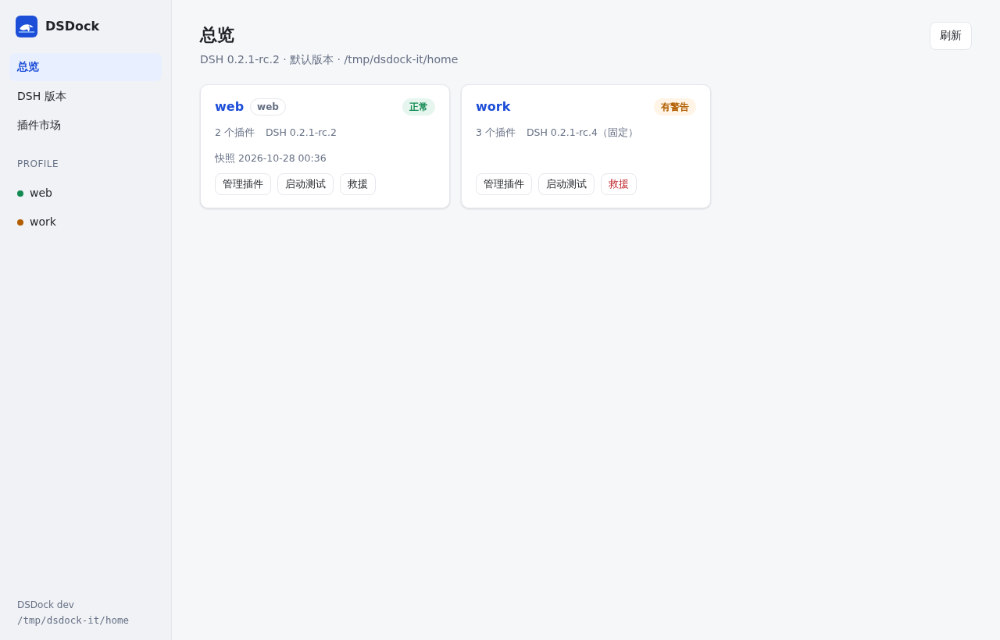
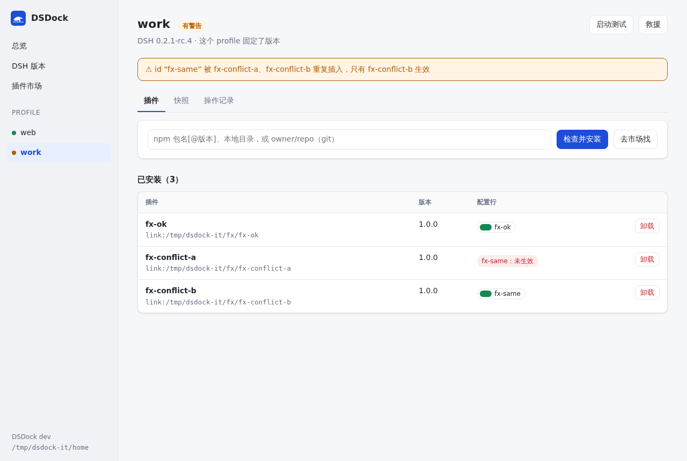
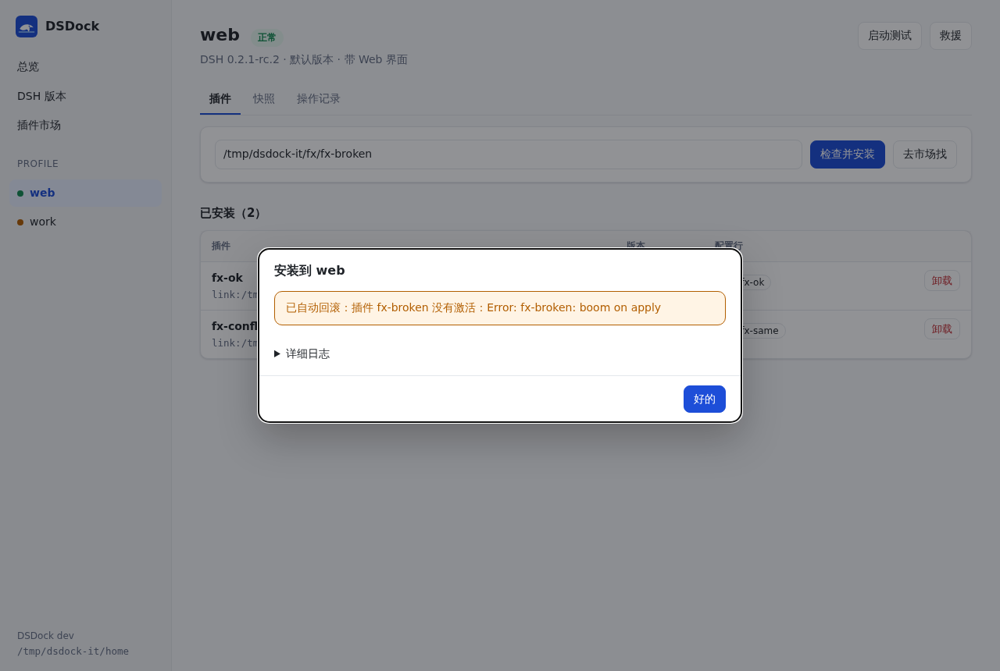
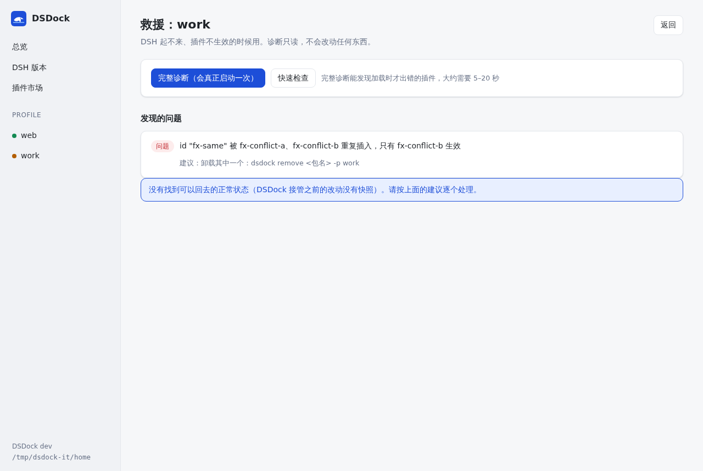
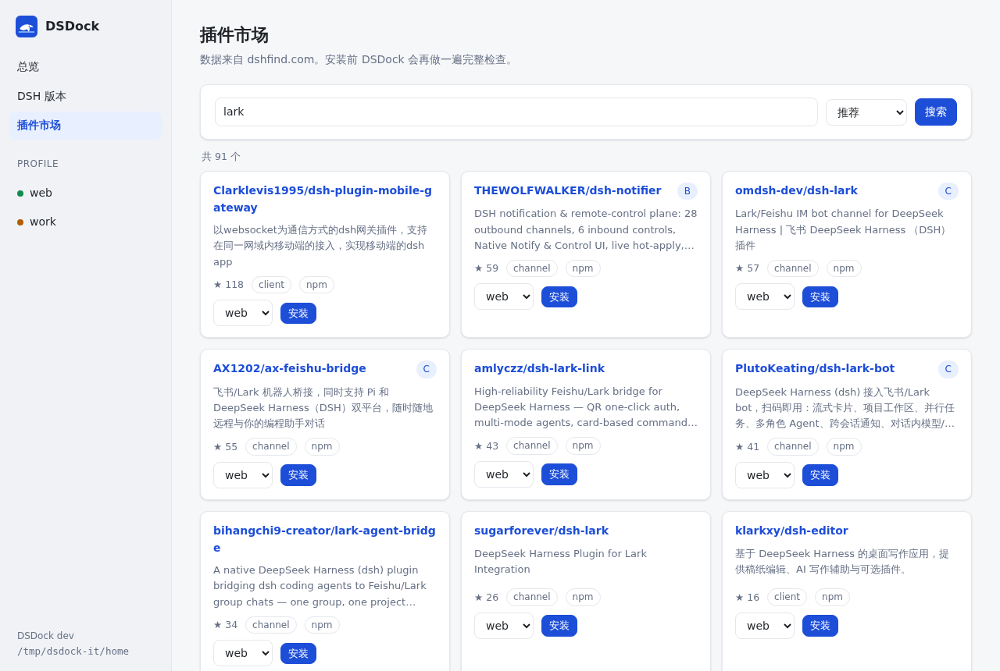

# DSDock

**DeepSeek Harness 的外部管理器**：DSH 版本管理，以及插件的安装、更新、快照、回滚、救援。

DSDock 不是 DSH 插件，不做聊天界面，也不替代 DSH。它在 DSH 外面工作，所以 DSH 起不来的时候也能把它救回来。

> 🚧 **预览阶段**：命令行和浏览器界面都可以用了——插件生命周期（安装、卸载、更新、禁用、快照、回滚、启动测试）、救援模式、DSH 版本管理（多版本并存、切换、按 profile 锁定、`dsh` 转发器）、插件市场。在 Linux 上对真实的 DSH 做过端到端测试；macOS 原生窗口和托盘（Wails）还在做。[下载 macOS 预览版](https://github.com/hikariming/dsdock/releases)



## 计划中的功能

- **安全安装**：装之前检查兼容性和风险 → 拍快照 → 安装 → 验证 → 失败自动回滚
- **快照与回滚**：每次变更前自动拍快照，一键回到任意一个时间点
- **救援模式**：DSH 起不来时诊断原因，回到上次正常的状态，二分定位出问题的插件
- **DSH 版本管理**：多个版本并存、一键切换、每个 profile 单独锁定版本、降级前警告
- **冲突分析**：哪个插件覆盖了哪个插件的配置，你写的覆盖在插件更新后是否已经过时
- **整合包**：导出、导入、分享一整套插件组合

## 图形界面

```bash
dsdock gui          # 在本机启动，并用浏览器打开
```

只监听 `127.0.0.1`，地址里带着这次运行的随机令牌。每个改动都是"先检查 → 你确认 → 执行"，改坏了会自动回滚：

| 插件管理（被重复 id 覆盖、实际不生效的配置会标出来） | 装上就报错的插件：自动回滚 |
|---|---|
|  |  |
| **救援：找出原因，一键回到上一个正常的状态** | **插件市场：数据来自 dshfind，安装前再做一遍检查** |
|  |  |

## 试用（命令行）

需要 Go 1.26 或更高版本，以及能运行 DSH 的环境（Node ≥ 24.9、pnpm）。

```bash
go build -o dsdock .

./dsdock status                                  # DSH 环境和所有 profile 的健康状态
./dsdock check dsh-meme -p web                   # 只做装前检查
./dsdock add dsh-meme -p web --smoke             # 安装，装完真正启动一次检查
./dsdock update dsh-meme -p web                  # 更新到兼容当前 DSH 的最新版本
./dsdock disable <id> -p web                     # 禁用一行配置，不卸载
./dsdock snap list -p web                        # 快照时间线
./dsdock snap restore <快照id>                    # 回到某个时间点（可撤销）
./dsdock smoke -p web                            # 启动测试：每个插件都激活了吗？
./dsdock rescue -p web                           # DSH 出问题了：找原因，一键回到上一个正常的状态
./dsdock outdated -p web                         # 哪些插件有兼容当前 DSH 的新版本
./dsdock help
```

DSH 版本管理：

```bash
./dsdock dsh list --available                    # 可以安装的版本（带 latest / next / alpha 渠道）
./dsdock dsh install latest                      # 第一个装上的版本自动设为默认
./dsdock dsh install next
./dsdock dsh use 0.2.1-rc.4                      # 切换前检查：哪些插件会被跳过、会话格式会不会降级
./dsdock dsh pin 0.2.1-rc.2 -p work              # 让 work 固定使用某个版本
./dsdock dsh shim                                # 装上转发器，之后在终端里敲 dsh 就会自动选对版本
./dsdock dsh adopt                               # 接管已有的 npm i -g 安装，不移动、不删除
```

每次改动之前都会自动拍快照；改动后配置无法组装、或者（加了 `--smoke` 时）插件没能激活，都会**自动回滚**。

DSDock 管理了版本之后就用它们（profile 锁定的版本优先，其次是默认版本）；还没有管理任何版本时用 PATH 里的 `dsh`。要临时指定某个安装，设置 `DSDOCK_DSH=<dsh 的 lib/bin.js>`（和 `DSDOCK_NODE=<node>`）。

装前检查会参考 [dshfind](https://dshfind.com) 的数据：被标记为有风险的仓库（比如冒用官方包名的假冒仓库）、已归档或长期不更新的仓库都会提示。

## 文档

- [设计方案](docs/design.zh-CN.md)
- [M0 实测接力手册](docs/m0-handoff.md)
- [M0 实测结果](docs/m0-results/)
- [子系统说明](docs/subsystems/)
- [LESSONS](LESSONS.md)：踩过的坑和由此定下的规则

## 许可证

[MIT](LICENSE)
